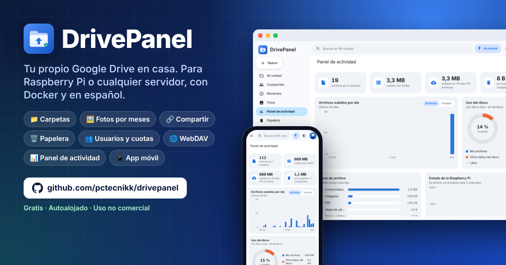
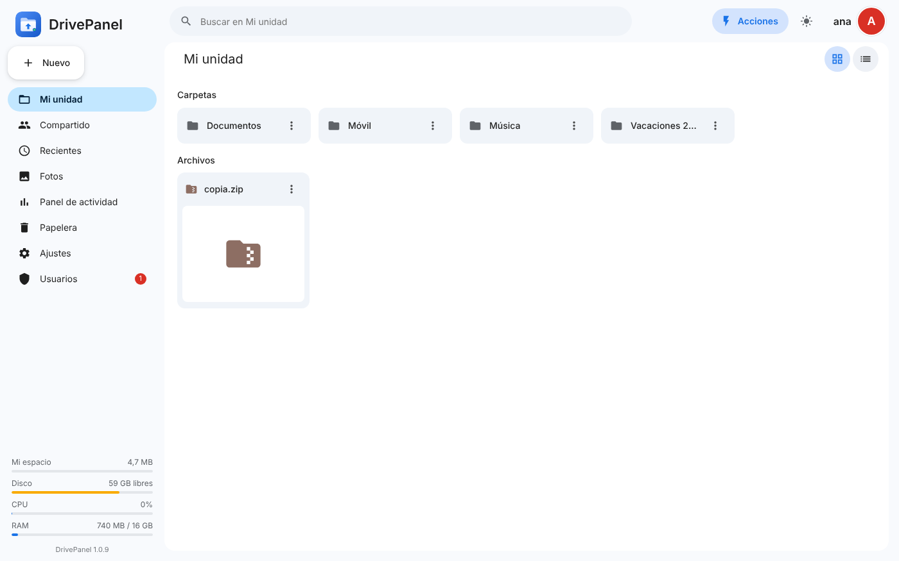
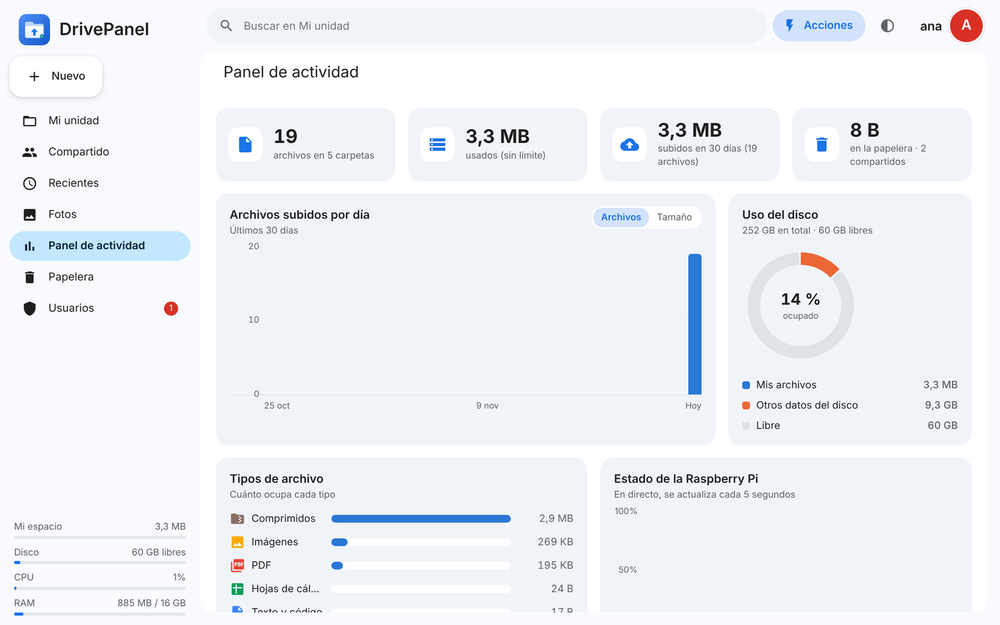
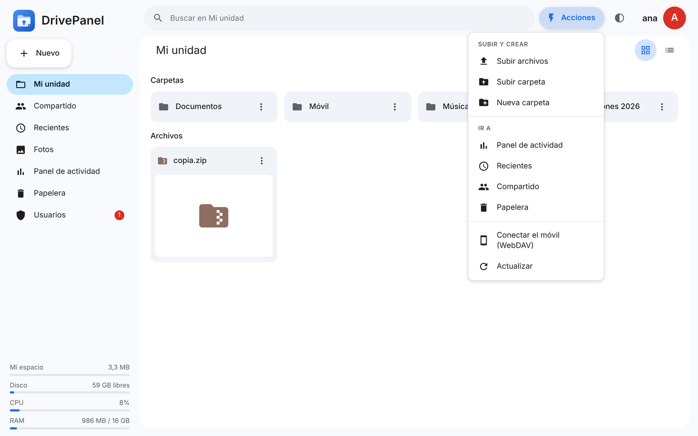
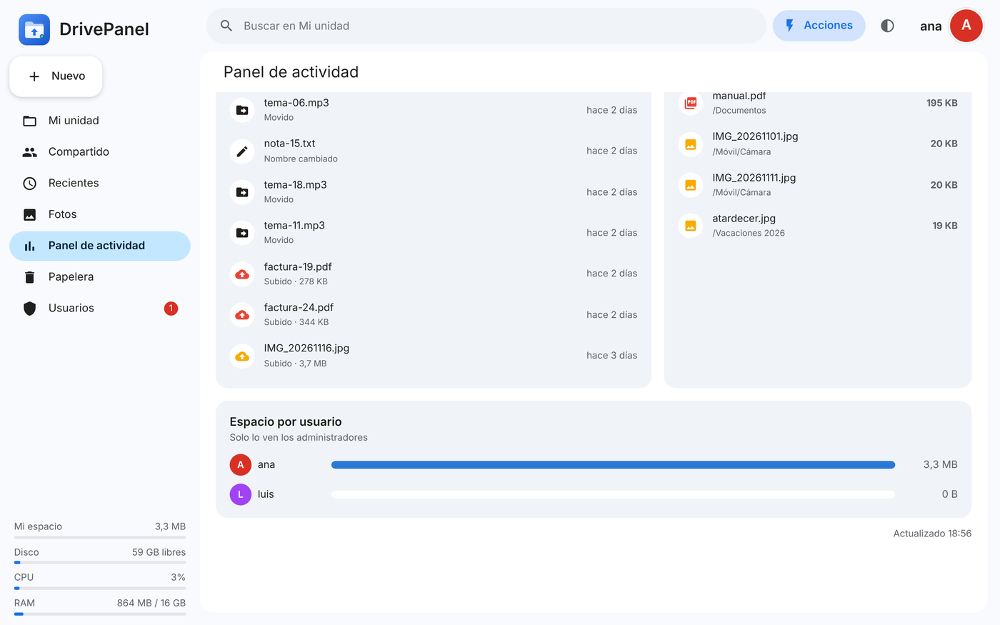
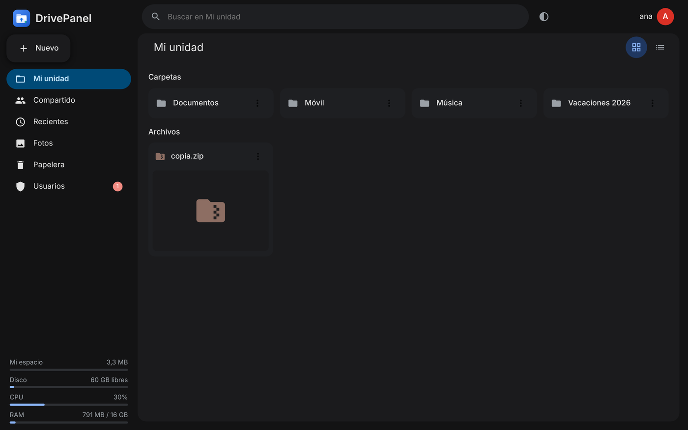
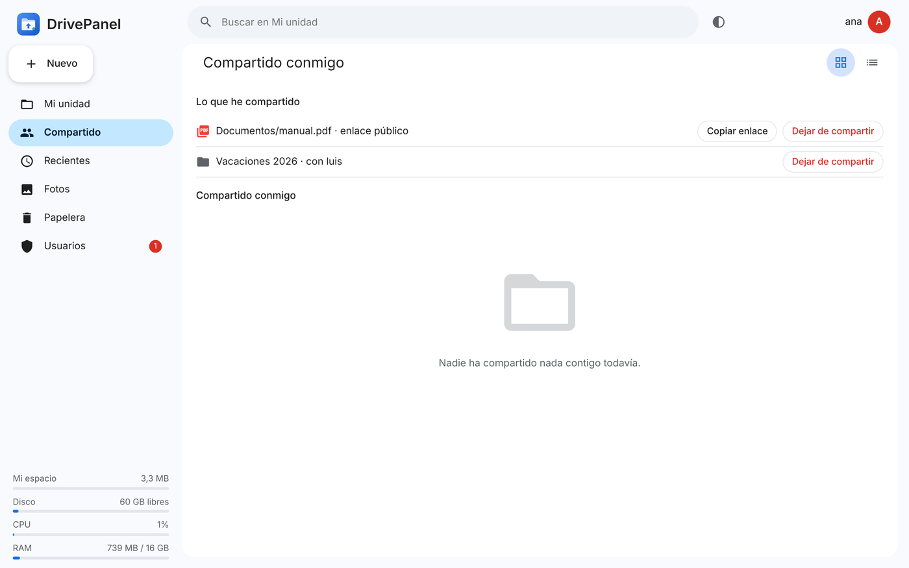
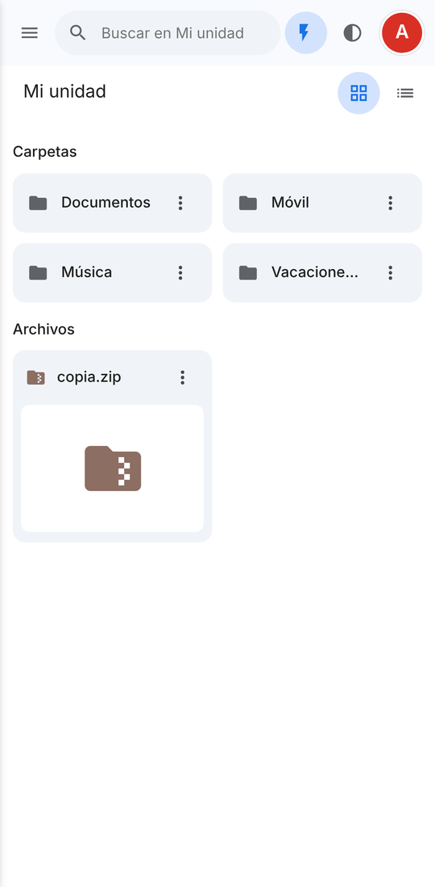
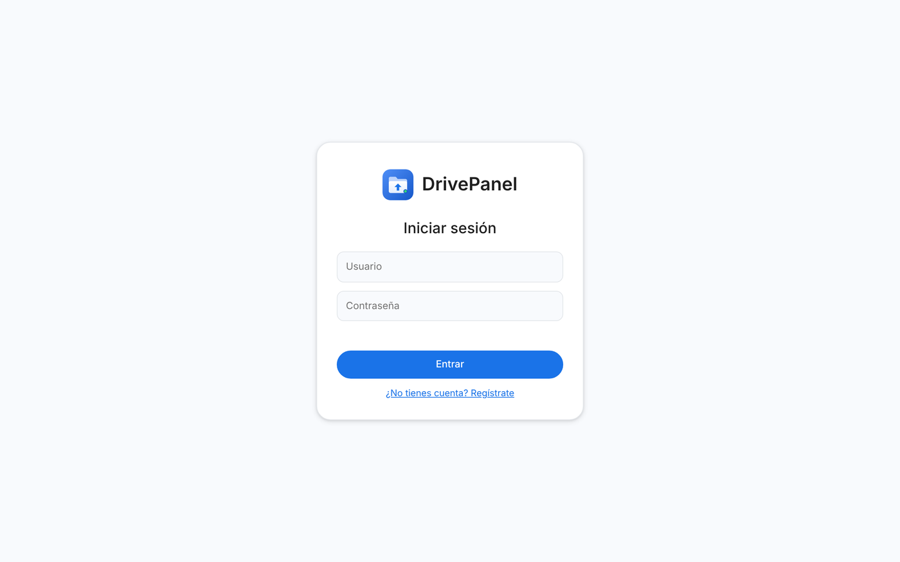

# DrivePanel



Tu propio "Google Drive" en casa, pensado para una Raspberry Pi (funciona en cualquier
Linux con Docker). Ligero (unos 40 MB de RAM), en español y en inglés, con modo claro/oscuro y
WebDAV para que el móvil suba las fotos solo.

> **Idiomas / Languages:** ahora DrivePanel está en español. **El inglés llegará muy pronto**,
> y más adelante otros idiomas si la gente los pide.
> DrivePanel is in Spanish right now. **English is coming very soon**, and more languages
> will follow later if people ask for them.

**Qué incluye:**

- **Mi unidad:** carpetas, cuadrícula con miniaturas o lista, búsqueda, renombrar, mover y
  **Propiedades** (tamaño real de una carpeta, cuántos archivos tiene y qué tipos).
- **Subidas:** archivos y carpetas enteras (botón, arrastrar y soltar o el menú **Acciones**),
  por trozos con reintentos, aviso de duplicados, y velocidad y tiempo restante en directo.
- **Panel de actividad:** gráfico de archivos subidos por día, uso del disco, tipos de
  archivo, estado de la Raspberry Pi en directo, actividad reciente, archivos más grandes y
  espacio por usuario (este último solo para el administrador).
- **Fotos** por meses o por álbumes, solo de las carpetas que elijas (como la de la copia del móvil); se cargan poco a poco. **Recientes**, visor de fotos, vídeo, PDF y texto, y descarga en .zip.
- **Papelera** con restaurar, también para lo que se borra por WebDAV.
- **Compartir** con otro usuario o con un enlace público que puede caducar.
- **Usuarios:** registro con aprobación del administrador, cuotas, foto de perfil.
- **WebDAV** por usuario en `/dav/`, para que el móvil suba las fotos solo.
- **Aviso de disco lleno:** avisa una vez al llegar a «casi lleno» (85 %) y otra al llegar a «lleno» (95 %), en la web y como notificación en la app del móvil. Si tienes un bot de Telegram, también te llega por Telegram (opcional, en **Ajustes → Avisos de disco lleno**; los pasos para crear el bot con @BotFather vienen ahí mismo).
- Se puede **instalar en el móvil** como app (desde el navegador o con la **APK para Android**), y tiene modo claro y oscuro.

Hecho con Python (FastAPI + SQLite) y JavaScript sin frameworks.

<details>
<summary><b>🇬🇧 English</b></summary>

### DrivePanel in English

Your own "Google Drive" at home, built for a Raspberry Pi (it works on any Linux machine
with Docker). Lightweight (about 40 MB of RAM), with light/dark mode and WebDAV so your
phone can upload photos on its own.

**Languages:** the app is available in **Spanish and English** (more may come). It opens in
your browser's language, and each user can change it in **Settings → Your preferences →
Language** (it is saved in the account, so it is the same on every device). Error
messages and public share pages also follow the language.

**What's included:** My Drive with folders, thumbnails, search, rename, move and
Properties · uploads of files and whole folders in chunks with retries, duplicate
warnings and live speed · activity dashboard (uploads per day, disk usage, file types,
live Raspberry Pi status) · Photos by month or by album · Recent, viewer for photos,
video, audio, PDF and text, .zip download · Trash · sharing with another user or with a
public link that can expire · users with admin approval and quotas · WebDAV at `/dav/` ·
installable on the phone (from the browser or with the Android APK).

**Install:**

```bash
git clone https://github.com/pctecnikk/drivepanel.git
cd drivepanel
./install.sh       # the first time it only creates the .env file
nano .env          # set DATA_DIR to a folder on your disk, e.g. /mnt/disk/drivepanel
./install.sh       # now it installs and starts
```

Open **http://YOUR-PI-IP:8090** and press **Sign up**. **The first user to sign up is the
administrator.** Later sign-ups stay *pending* until the admin approves them in **Users**.
You can also set `ADMIN_USER` and `ADMIN_PASSWORD` in `.env` to create the admin at start.

**Main `.env` settings:** `DATA_DIR` (where everything is stored), `PORT` (default 8090),
`TZ`, `PUID`/`PGID`, `DEFAULT_QUOTA_GB` (0 = no limit), `ADMIN_USER`/`ADMIN_PASSWORD`,
`ALLOW_REGISTER` (`0` = only the admin creates accounts).

**Update:** `cd drivepanel && git pull && docker compose up -d --build`. Your files and users
are kept in `DATA_DIR`.

**Adding a language:** copy `app/static/i18n/en.json` to `<code>.json`, translate the
values (the keys are the Spanish texts) and add the code to `LANGS` in
`app/static/i18n.js` and `app/i18n.py`.

</details>





<details>
<summary><b>Más capturas</b></summary>

| | |
|---|---|
|  |  |
| **Acciones**: subir y crear desde arriba | **Propiedades** de una carpeta |
|  |  |
| **Actividad reciente** y espacio por usuario | **Modo oscuro** |
|  |  |
| **Fotos**, agrupadas por meses | **Compartido**, con usuarios o por enlace |
|  |  |
| **Usuarios** (administrador) | **En el móvil** |
|  | |
| **Pantalla de entrada** | |

</details>

---

## Cómo funcionan las subidas y las descargas

Explicado en sencillo, para que sepas qué pasa cuando subes algo:

- **Se sube en trozos de 32 MB.** Un archivo grande (un vídeo de 4 GB, por ejemplo) no se
  manda de golpe: se parte en trozos de 32 MB y se envían uno detrás de otro. El servidor
  los va juntando y, al llegar el último, el archivo aparece en su carpeta.
- **Si se corta, solo se repite el trozo que falló.** Si se cae el Wi-Fi o el servidor tarda,
  la web lo vuelve a intentar sola (hasta 5 veces, esperando un poco más cada vez). No
  empieza el archivo desde cero: sigue desde el último trozo que llegó bien.
- **Si aun así falla,** el archivo se queda en el panel de subidas en rojo, con el motivo y un
  botón **Reintentar fallidos** que continúa desde donde se quedó. Lo subido a medias que
  nadie continúa se borra solo a los 2 días.
- **Se suben 2 archivos a la vez** (con el perfil Raspberry Pi 4). El resto espera en cola.
  El administrador lo cambia en **Ajustes → Máquina donde funciona DrivePanel**:

  | Perfil | Subidas a la vez | Tamaño de cada trozo | Miniaturas a la vez |
  |---|---|---|---|
  | Raspberry Pi 3 (o Pi 2 / Zero 2) | 1 | 16 MB | 1 |
  | Raspberry Pi 4 (o Pi 400) | 2 | 32 MB | 2 |
  | Raspberry Pi 5 | 3 | 32 MB | 3 |
  | PC o servidor (también Proxmox, Debian, Ubuntu…) | 4 | 64 MB | 4 |
  | Personalizado | 1 a 6 | 8 a 64 MB | 1 a 4 |

  DrivePanel detecta en qué máquina está y te sugiere el perfil. Si no eliges ninguno, usa
  el sugerido.
- **Archivos repetidos:** antes de subir, DrivePanel mira si ya existen en la carpeta y te
  pregunta, como Windows: omitir, reemplazar o conservar los dos.
- **En directo**, como la ventana de copiar de Windows 11: el porcentaje, el archivo que se
  está subiendo, una gráfica de la velocidad, el tiempo que queda y los elementos que faltan.
- **Papelera:** lo que borras (también por WebDAV) no desaparece, va a la **Papelera**.
  Desde ahí lo restauras o lo borras para siempre. Lo que está en la Papelera sigue
  ocupando espacio hasta que la vacías.
- **Descargas:** desde la web, una carpeta o varios archivos se descargan juntos en un .zip.
  En la **app Android** las descargas van a la carpeta **Descargas** del móvil y abajo sale
  un **panel de descargas** con lo que lleva cada una, la velocidad, el tiempo que queda y
  botones para cancelar, reintentar o abrir.

---

## 1. Requisitos

- Una Raspberry Pi 4/5 (o cualquier equipo Linux) con **Docker** y **Docker Compose**.
- **Recomendado: Raspberry Pi 4 o 5.** La Pi 3 funciona, pero con poca memoria (1 GB) irá lenta con fotos, miniaturas y subidas grandes.
  Si no lo tienes: `curl -fsSL https://get.docker.com | sh` y luego
  `sudo usermod -aG docker $USER` (cierra la sesión y vuelve a entrar).
- Recomendado: un **disco externo** montado para guardar los archivos, en vez de la
  tarjeta SD.

## 2. Instalar

```bash
git clone https://github.com/pctecnikk/drivepanel.git
cd drivepanel
./install.sh       # la primera vez solo crea el archivo .env con tu usuario
nano .env          # cambia DATA_DIR a la carpeta de tu disco, por ejemplo /mnt/disco/drive-panel
./install.sh       # ahora sí instala y arranca
```

La segunda vez, `install.sh` crea las carpetas de datos con tu usuario como dueño y hace
`docker compose up -d --build`. La primera instalación tarda unos minutos (descarga
Python e instala las dependencias). No hace falta instalar nada más: la base de datos
(SQLite) se crea sola dentro de `DATA_DIR/config/` al arrancar.

Si prefieres hacerlo a mano:

```bash
sudo mkdir -p /mnt/disco/drive-panel
sudo chown -R $(id -u):$(id -g) /mnt/disco/drive-panel
docker compose up -d --build
```

### Primer acceso

Abre **http://IP-DE-TU-PI:8090** y pulsa **Regístrate**. **El primer usuario que se
registra es el administrador** y entra directamente. Los siguientes quedan *pendientes*
hasta que los apruebes en **Usuarios** (ahí también pones la cuota en GB, 0 = sin límite,
creas cuentas, bloqueas, cambias contraseñas o eliminas cuentas).

Si prefieres que el administrador exista desde el principio, pon `ADMIN_USER` y
`ADMIN_PASSWORD` en el `.env` antes de arrancar.

## 3. Configuración (`.env`)

| Variable | Para qué sirve | Por defecto |
|---|---|---|
| `DATA_DIR` | Carpeta donde se guarda todo | `./data` |
| `PORT` | Puerto de la web | `8090` |
| `TZ` | Zona horaria | `Europe/Madrid` |
| `PUID` / `PGID` | Usuario y grupo dueños de los archivos | `1000` |
| `DEFAULT_QUOTA_GB` | Cuota para usuarios nuevos (0 = sin límite) | `0` |
| `ADMIN_USER` / `ADMIN_PASSWORD` | Crea ese administrador al arrancar si no existe | vacío |
| `ALLOW_REGISTER` | `1` = cualquiera puede pedir cuenta (el admin la aprueba); `0` = solo el admin crea cuentas | `1` |

Después de cambiar algo: `docker compose up -d`.

**Qué hay dentro de `DATA_DIR`:**

| Carpeta | Qué hay |
|---|---|
| `storage/<usuario>` | Los archivos de cada usuario |
| `config/` | Base de datos (usuarios, sesiones, compartidos) y fotos de perfil |
| `trash/<usuario>` | Papelera |
| `cache/` y `tmp/` | Miniaturas y subidas en curso |
| `archivo/` | Archivos de cuentas eliminadas sin borrar sus datos |

## 4. Actualizar

```bash
cd drivepanel
git pull
docker compose up -d --build
```

Tus archivos y usuarios no se tocan: están en `DATA_DIR`, no en la carpeta de la app.

## 5. App para Android (APK)

> ⚠️ **Antes de nada: la app necesita tu propio servidor DrivePanel ya instalado y funcionando**
> (en una Raspberry Pi o cualquier Linux con Docker). La app solo es la ventana para entrar en
> él desde el móvil: sin servidor no hace nada. Si aún no lo tienes, sigue primero los pasos de
> **[Instalar](#2-instalar)** y comprueba que entras desde el navegador.

Además de instalarla desde el navegador, hay una **app para Android** que se descarga desde
GitHub. Es la misma web de DrivePanel dentro de una app, así que siempre está al día con tu
servidor.

**Instalarla en el móvil:**

1. Abre en el móvil la página de **[descargas (Releases)](https://github.com/pctecnikk/drivepanel/releases)**, busca la más nueva
   que se llama **App Android** y toca **`DrivePanel.apk`**.
2. Al abrir el archivo, Android pedirá permiso para **instalar apps de origen desconocido**
   (el navegador o la app *Archivos*). Dale permiso y toca **Instalar**.
   Si aparece un aviso de *Play Protect*, toca **Más detalles → Instalar de todas formas**:
   sale porque la app no viene de Google Play.
3. Abre **DrivePanel** y escribe la **dirección de tu servidor**, la misma que usas en el
   navegador (por ejemplo `192.168.1.x:8090`). La app comprueba que es un DrivePanel y la
   recuerda.

> **Ojo, en casa o fuera de casa:** la dirección con la IP de casa (`192.168.…:8090`) **solo
> funciona conectado a la wifi de casa**. Con datos móviles o en otra wifi hay que poner la
> dirección pública de tu servidor (por ejemplo `https://nube.midominio.com`), si la tienes.
> Puedes cambiarla cuando quieras con **Cambiar servidor**.

**Qué hace:**

- Entrar con tu usuario, ver y abrir tus archivos, fotos, vídeos y PDF.
- **Subir** archivos y fotos desde el móvil (puedes elegir varios a la vez).
- **Compartir con DrivePanel:** en la galería, WhatsApp o cualquier app, toca **Compartir** y
  elige **DrivePanel**. La app pregunta la carpeta (por defecto *Del móvil*; se crea sola) y lo
  sube con el panel de subidas.
- **Copia automática de fotos**, como Google Fotos: pulsa **Atrás** → **Copia automática de
  fotos** y actívala. La app sube sola las fotos y vídeos nuevos a una carpeta de DrivePanel
  (por defecto *Fotos del móvil*, con una subcarpeta por álbum). Puedes elegir solo con wifi,
  solo las de la cámara (sin WhatsApp ni capturas) y si copia también las que ya tenías.
  Mientras copia ves el progreso, la velocidad y el tiempo que queda, y puedes **pausarla** o
  **cancelarla** desde la app o desde el aviso. Lo que ya está subido no se repite.
- **Al abrir** entras en el **Panel de actividad**. Para empezar en **Mi unidad**, pulsa
  **Atrás** y elige **Pantalla al abrir**.
- **Subir carpetas enteras**, con sus subcarpetas: en **Acciones** elige **Subir carpeta**,
  busca la carpeta y toca **Usar esta carpeta**. (Android no deja elegir la raíz de la memoria
  ni la carpeta Descargas entera; elige una carpeta de dentro.)
- **Descargar** archivos y carpetas (.zip): se guardan en la carpeta **Descargas** del móvil.
  Abajo sale un **panel de descargas** con lo que lleva cada archivo, la velocidad y el tiempo
  que queda, y botones para cancelar, reintentar o abrir.
- **Cambiar de servidor:** mantén pulsado el icono de DrivePanel y elige **Cambiar servidor**,
  o pulsa **Atrás** en la pantalla principal de la app.
- Si el servidor no responde, la app te deja **reintentar** o cambiar la dirección.
- **Versión y novedades:** pulsa **Atrás** en la pantalla principal y elige **Novedades**, o
  mantén pulsado el icono. La lista completa está en
  [`android/src/main/res/raw/novedades.md`](android/src/main/res/raw/novedades.md).
- **Qué versión tienes:** abajo del todo del menú lateral y en tu menú de usuario (la foto de
  arriba a la derecha) se ve la versión del servidor y, en la app, también la de la app.
- **Actualizaciones:** la app mira en GitHub si hay una versión nueva y te avisa. Al descargarla
  se instala encima de la que tienes, sin perder nada.

Necesita Android 7 o más nuevo.

<details>
<summary>Compilar la APK tú mismo</summary>

El código está en la carpeta [`android/`](android/). En Ubuntu o Debian:

```bash
sudo apt install default-jdk aapt apksigner zipalign dalvik-exchange
./android/build.sh
```

La APK queda en `android/build/`. Sin más opciones se firma con una clave de prueba; para
firmarla con la tuya usa `KEYSTORE=... KS_PASS=... KEY_ALIAS=... ./android/build.sh`.

**Cómo se numeran las versiones:** de poco en poco, subiendo el último número. La app va
por la 1.6, así que las siguientes son 1.6.1, 1.6.2, 1.6.3… y el servidor (`app/VERSION`)
1.0.1, 1.0.2… Solo se sube el número del medio para un cambio grande.

**Sacar una versión nueva:** sube `versionCode` y `versionName` en
`android/src/main/AndroidManifest.xml`, apunta las novedades arriba del todo en
`android/src/main/res/raw/novedades.md`, compila con tu clave, copia la APK a `android/dist/DrivePanel.apk` y súbelo a `main`.
GitHub crea solo la Release `android-vX.Y` con la APK y las novedades. La app avisa sola a quien tenga una versión
anterior.

</details>

### ¿Y en iPhone o iPad?

La app es **solo para Android**. En iPhone y iPad no hay app, pero puedes usar DrivePanel
desde el navegador y dejarlo en la pantalla de inicio como si fuera una app:

1. Abre **Safari** y entra en la dirección de tu DrivePanel (la misma que usas en el PC).
2. Inicia sesión con tu usuario.
3. Toca el botón **Compartir** (el cuadrado con la flecha hacia arriba).
4. Baja y toca **Añadir a pantalla de inicio**, y luego **Añadir**.
5. Ya tienes el icono de DrivePanel en la pantalla de inicio: se abre a pantalla completa.

Funciona casi todo: ver y abrir archivos, fotos y vídeos, subir archivos y fotos, crear
carpetas, compartir enlaces, el Panel de actividad y los Ajustes. **Lo que no hay en iPhone:**

- **El menú Compartir del sistema:** no puedes elegir "DrivePanel" al compartir desde la
  galería o WhatsApp. Abre DrivePanel y súbelo desde ahí.
- **Descargas en segundo plano y el panel de descargas:** las descargas las hace Safari y
  se cortan si cierras Safari o bloqueas el iPhone durante un rato. Lo mismo con las subidas:
  deja la pantalla abierta hasta que terminen.
- **Subir carpetas enteras:** iOS solo deja elegir archivos sueltos o fotos.
- **La copia automática de fotos** de la app Android (para eso usa WebDAV, mira abajo).

Para que las fotos se suban solas también en iPhone, usa **WebDAV** con una app como
PhotoSync (mira la sección de WebDAV más abajo).

## 6. Subida automática desde el móvil (WebDAV)

Cada usuario tiene su "Mi unidad" disponible por WebDAV. Dentro de la app lo tienes en
el menú de usuario → **Conectar el móvil (WebDAV)**.

- **Servidor:** `http://IP-DE-TU-PI:8090/dav/`
- **Usuario y contraseña:** los mismos de DrivePanel

**FolderSync (Android):**

1. *Cuentas* → **+** → **WebDAV**. URL del servidor: `http://IP-DE-TU-PI:8090/dav/`,
   tu usuario y contraseña. Desactiva HTTPS (o actívalo si usas un proxy con HTTPS).
   Pulsa *Probar*.
2. *Folderpairs* → **+**. Cuenta: la de arriba. Tipo de sincronización:
   **Hacia la carpeta remota**.
   - Carpeta remota: crea por ejemplo `/Móvil/Cámara`
   - Carpeta local: `DCIM/Camera`
3. Activa *Sincronización programada* (por ejemplo cada hora) y, si quieres,
   *Sincronizar al detectar cambios* y *Solo con Wi-Fi*.

Las fotos aparecerán en **Mi unidad → Móvil → Cámara** y también en **Fotos**.
La cuota también se aplica a lo que llega por WebDAV.

Otras apps que funcionan igual: PhotoSync (Android e iPhone), Solid Explorer o el
explorador de Windows ("Conectar a unidad de red" → `http://IP-DE-TU-PI:8090/dav/`).

## 7. Comandos útiles

```bash
docker compose ps                 # estado
docker compose logs -f            # ver registros (Ctrl+C para salir)
docker compose restart            # reiniciar
docker compose down               # parar
```

**Copia de seguridad:** copia la carpeta `DATA_DIR` entera. Si solo quieres guardar
usuarios y compartidos, basta con `DATA_DIR/config/`.

## 8. Seguridad

- La app usa **HTTP sin cifrar**. No abras el puerto 8090 en el router.
- Para entrar desde fuera de casa usa una VPN (por ejemplo Tailscale o WireGuard) o un
  proxy inverso con HTTPS (Caddy, Nginx Proxy Manager, Traefik...).
- Las contraseñas no se guardan tal cual, sino como hash PBKDF2. Usa contraseñas largas, sobre todo
  si la expones fuera de tu red.
- Tras varios intentos fallidos de entrar (web o WebDAV) se bloquea un rato a quien lo intenta.
  Si no quieres que desconocidos pidan cuenta, pon `ALLOW_REGISTER=0`.
- Cambiar la contraseña cierra las demás sesiones abiertas.
- Los archivos que pueden ejecutar código (HTML, SVG...) no se abren en el navegador:
  se muestran como texto o se descargan, para que un usuario no pueda atacar a otro
  compartiéndole un archivo.

## 9. Licencia

DrivePanel se publica con la licencia
[PolyForm Noncommercial 1.0.0](LICENSE.md). En resumen (el texto que vale es el de
la licencia):

- ✅ Puedes usarlo gratis en tu casa, para ti, tu familia, tus amigos, un colegio o
  una asociación sin ánimo de lucro.
- ✅ Puedes ver el código, modificarlo y compartir tus cambios, siempre que mantengas
  el aviso de licencia y de autor.
- ❌ **No puedes venderlo** ni usarlo con fines comerciales (por ejemplo cobrar por
  instalarlo, ofrecerlo como servicio de pago o incluirlo en un producto que vendas).

Si quieres usarlo con fines comerciales, escribe al autor por GitHub.

Copyright (c) 2026 [pctecnikk](https://github.com/pctecnikk)
