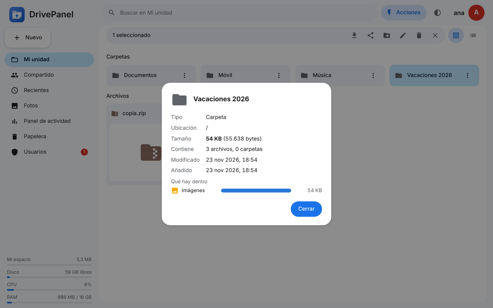
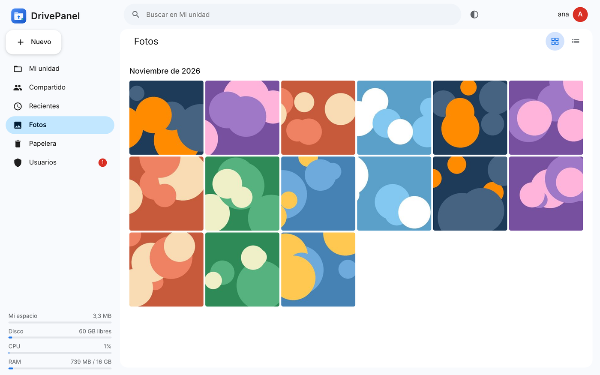
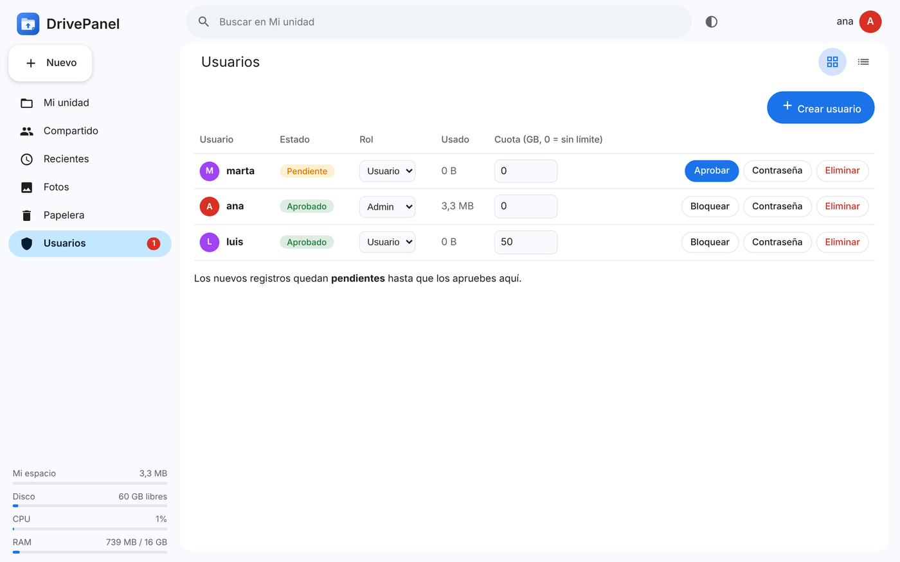

# DrivePanel

Tu propio "Google Drive" en casa, pensado para una Raspberry Pi (funciona en cualquier
Linux con Docker). Ligero (unos 40 MB de RAM), en español, con modo claro/oscuro y
WebDAV para que el móvil suba las fotos solo.

**Qué incluye:**

- **Mi unidad:** carpetas, cuadrícula con miniaturas o lista, búsqueda, renombrar, mover y
  **Propiedades** (tamaño real de una carpeta, cuántos archivos tiene y qué tipos).
- **Subidas:** archivos y carpetas enteras (botón, arrastrar y soltar o el menú **Acciones**),
  por trozos con reintentos, aviso de duplicados, y velocidad y tiempo restante en directo.
- **Panel de actividad:** gráfico de archivos subidos por día, uso del disco, tipos de
  archivo, estado de la Raspberry Pi en directo, actividad reciente, archivos más grandes y
  espacio por usuario (este último solo para el administrador).
- **Fotos** por meses, **Recientes**, visor de fotos, vídeo, PDF y texto, y descarga en .zip.
- **Papelera** con restaurar, también para lo que se borra por WebDAV.
- **Compartir** con otro usuario o con un enlace público que puede caducar.
- **Usuarios:** registro con aprobación del administrador, cuotas, foto de perfil.
- **WebDAV** por usuario en `/dav/`, para que el móvil suba las fotos solo.
- Se puede **instalar en el móvil** como app (desde el navegador o con la **APK para Android**), y tiene modo claro y oscuro.

Hecho con Python (FastAPI + SQLite) y JavaScript sin frameworks.


<details>
<summary><b>Más capturas</b></summary>

| | |
|---|---|
|  |  |
| **Acciones**: subir y crear desde arriba | **Propiedades** de una carpeta |
|  |  |
| **Actividad reciente** y espacio por usuario | **Modo oscuro** |
|  |  |
| **Fotos**, agrupadas por meses | **Compartido**, con usuarios o por enlace |
|  |  |
| **Usuarios** (administrador) | **En el móvil** |
|  | |
| **Pantalla de entrada** | |

</details>

---

## 1. Requisitos

- Una Raspberry Pi 4/5 (o cualquier equipo Linux) con **Docker** y **Docker Compose**.
- **También funciona en una Raspberry Pi 3**, pero tiene poca potencia: las miniaturas,
  ver fotos y las subidas grandes irán lentas. Para un uso diario cómodo, mejor una Pi 4 o 5.
  Si no lo tienes: `curl -fsSL https://get.docker.com | sh` y luego
  `sudo usermod -aG docker $USER` (cierra la sesión y vuelve a entrar).
- Recomendado: un **disco externo** montado para guardar los archivos, en vez de la
  tarjeta SD.

## 2. Instalar

```bash
git clone https://github.com/pctecnikk/drivepanel.git
cd drivepanel
./install.sh       # la primera vez solo crea el archivo .env con tu usuario
nano .env          # cambia DATA_DIR a la carpeta de tu disco, por ejemplo /mnt/disco/drive-panel
./install.sh       # ahora sí instala y arranca
```

La segunda vez, `install.sh` crea las carpetas de datos con tu usuario como dueño y hace
`docker compose up -d --build`. La primera instalación tarda unos minutos (descarga
Python e instala las dependencias). No hace falta instalar nada más: la base de datos
(SQLite) se crea sola dentro de `DATA_DIR/config/` al arrancar.

Si prefieres hacerlo a mano:

```bash
sudo mkdir -p /mnt/disco/drive-panel
sudo chown -R $(id -u):$(id -g) /mnt/disco/drive-panel
docker compose up -d --build
```

### Primer acceso

Abre **http://IP-DE-TU-PI:8090** y pulsa **Regístrate**. **El primer usuario que se
registra es el administrador** y entra directamente. Los siguientes quedan *pendientes*
hasta que los apruebes en **Usuarios** (ahí también pones la cuota en GB, 0 = sin límite,
creas cuentas, bloqueas, cambias contraseñas o eliminas cuentas).

Si prefieres que el administrador exista desde el principio, pon `ADMIN_USER` y
`ADMIN_PASSWORD` en el `.env` antes de arrancar.

## 3. Configuración (`.env`)

| Variable | Para qué sirve | Por defecto |
|---|---|---|
| `DATA_DIR` | Carpeta donde se guarda todo | `./data` |
| `PORT` | Puerto de la web | `8090` |
| `TZ` | Zona horaria | `Europe/Madrid` |
| `PUID` / `PGID` | Usuario y grupo dueños de los archivos | `1000` |
| `DEFAULT_QUOTA_GB` | Cuota para usuarios nuevos (0 = sin límite) | `0` |
| `ADMIN_USER` / `ADMIN_PASSWORD` | Crea ese administrador al arrancar si no existe | vacío |
| `ALLOW_REGISTER` | `1` = cualquiera puede pedir cuenta (el admin la aprueba); `0` = solo el admin crea cuentas | `1` |

Después de cambiar algo: `docker compose up -d`.

**Qué hay dentro de `DATA_DIR`:**

| Carpeta | Qué hay |
|---|---|
| `storage/<usuario>` | Los archivos de cada usuario |
| `config/` | Base de datos (usuarios, sesiones, compartidos) y fotos de perfil |
| `trash/<usuario>` | Papelera |
| `cache/` y `tmp/` | Miniaturas y subidas en curso |
| `archivo/` | Archivos de cuentas eliminadas sin borrar sus datos |

## 4. Actualizar

```bash
cd drivepanel
git pull
docker compose up -d --build
```

Tus archivos y usuarios no se tocan: están en `DATA_DIR`, no en la carpeta de la app.

## 5. App para Android (APK)

Además de instalarla desde el navegador, hay una **app para Android** que se descarga desde
GitHub. Es la misma web de DrivePanel dentro de una app, así que siempre está al día con tu
servidor.

**Instalarla en el móvil:**

1. Abre en el móvil la página de **[descargas (Releases)](https://github.com/pctecnikk/drivepanel/releases)**, busca la más nueva
   que se llama **App Android** y toca **`DrivePanel.apk`**.
2. Al abrir el archivo, Android pedirá permiso para **instalar apps de origen desconocido**
   (el navegador o la app *Archivos*). Dale permiso y toca **Instalar**.
   Si aparece un aviso de *Play Protect*, toca **Más detalles → Instalar de todas formas**:
   sale porque la app no viene de Google Play.
3. Abre **DrivePanel** y escribe la **dirección de tu servidor**, la misma que usas en el
   navegador (por ejemplo `192.168.1.50:8090`). La app comprueba que es un DrivePanel y la
   recuerda.

> **Ojo, en casa o fuera de casa:** la dirección con la IP de casa (`192.168.…:8090`) **solo
> funciona conectado a la wifi de casa**. Con datos móviles o en otra wifi hay que poner la
> dirección pública de tu servidor (por ejemplo `https://nube.midominio.com`), si la tienes.
> Puedes cambiarla cuando quieras con **Cambiar servidor**.

**Qué hace:**

- Entrar con tu usuario, ver y abrir tus archivos, fotos, vídeos y PDF.
- **Subir** archivos y fotos desde el móvil (puedes elegir varios a la vez).
- **Descargar** archivos y carpetas (.zip): se guardan en la carpeta **Descargas** del móvil.
- **Cambiar de servidor:** mantén pulsado el icono de DrivePanel y elige **Cambiar servidor**,
  o pulsa **Atrás** en la pantalla principal de la app.
- Si el servidor no responde, la app te deja **reintentar** o cambiar la dirección.
- **Versión y novedades:** pulsa **Atrás** en la pantalla principal y elige **Novedades**, o
  mantén pulsado el icono. La lista completa está en
  [`android/src/main/res/raw/novedades.md`](android/src/main/res/raw/novedades.md).
- **Actualizaciones:** la app mira en GitHub si hay una versión nueva y te avisa. Al descargarla
  se instala encima de la que tienes, sin perder nada.

Necesita Android 7 o más nuevo. En la app de Android
no se puede elegir una **carpeta entera** para subir (Android no lo permite); para eso usa el
ordenador, o la subida automática por WebDAV.

<details>
<summary>Compilar la APK tú mismo</summary>

El código está en la carpeta [`android/`](android/). En Ubuntu o Debian:

```bash
sudo apt install default-jdk aapt apksigner zipalign dalvik-exchange
./android/build.sh
```

La APK queda en `android/build/`. Sin más opciones se firma con una clave de prueba; para
firmarla con la tuya usa `KEYSTORE=... KS_PASS=... KEY_ALIAS=... ./android/build.sh`.

**Sacar una versión nueva:** sube `versionCode` y `versionName` en
`android/src/main/AndroidManifest.xml`, apunta las novedades arriba del todo en
`android/src/main/res/raw/novedades.md`, compila con tu clave y crea una Release en el repo
público con la etiqueta `android-vX.Y` (por ejemplo `android-v1.2`) y el archivo
`DrivePanel.apk`. La app avisa sola a quien tenga una versión anterior.

</details>

## 6. Subida automática desde el móvil (WebDAV)

Cada usuario tiene su "Mi unidad" disponible por WebDAV. Dentro de la app lo tienes en
el menú de usuario → **Conectar el móvil (WebDAV)**.

- **Servidor:** `http://IP-DE-TU-PI:8090/dav/`
- **Usuario y contraseña:** los mismos de DrivePanel

**FolderSync (Android):**

1. *Cuentas* → **+** → **WebDAV**. URL del servidor: `http://IP-DE-TU-PI:8090/dav/`,
   tu usuario y contraseña. Desactiva HTTPS (o actívalo si usas un proxy con HTTPS).
   Pulsa *Probar*.
2. *Folderpairs* → **+**. Cuenta: la de arriba. Tipo de sincronización:
   **Hacia la carpeta remota**.
   - Carpeta remota: crea por ejemplo `/Móvil/Cámara`
   - Carpeta local: `DCIM/Camera`
3. Activa *Sincronización programada* (por ejemplo cada hora) y, si quieres,
   *Sincronizar al detectar cambios* y *Solo con Wi-Fi*.

Las fotos aparecerán en **Mi unidad → Móvil → Cámara** y también en **Fotos**.
La cuota también se aplica a lo que llega por WebDAV.

Otras apps que funcionan igual: PhotoSync (Android e iPhone), Solid Explorer o el
explorador de Windows ("Conectar a unidad de red" → `http://IP-DE-TU-PI:8090/dav/`).

## 7. Comandos útiles

```bash
docker compose ps                 # estado
docker compose logs -f            # ver registros (Ctrl+C para salir)
docker compose restart            # reiniciar
docker compose down               # parar
```

**Copia de seguridad:** copia la carpeta `DATA_DIR` entera. Si solo quieres guardar
usuarios y compartidos, basta con `DATA_DIR/config/`.

## 8. Seguridad

- La app usa **HTTP sin cifrar**. No abras el puerto 8090 en el router.
- Para entrar desde fuera de casa usa una VPN (por ejemplo Tailscale o WireGuard) o un
  proxy inverso con HTTPS (Caddy, Nginx Proxy Manager, Traefik...).
- Las contraseñas no se guardan tal cual, sino como hash PBKDF2. Usa contraseñas largas, sobre todo
  si la expones fuera de tu red.
- Tras varios intentos fallidos de entrar (web o WebDAV) se bloquea un rato a quien lo intenta.
  Si no quieres que desconocidos pidan cuenta, pon `ALLOW_REGISTER=0`.
- Cambiar la contraseña cierra las demás sesiones abiertas.
- Los archivos que pueden ejecutar código (HTML, SVG...) no se abren en el navegador:
  se muestran como texto o se descargan, para que un usuario no pueda atacar a otro
  compartiéndole un archivo.

## 9. Licencia

DrivePanel se publica con la licencia
[PolyForm Noncommercial 1.0.0](LICENSE.md). En resumen (el texto que vale es el de
la licencia):

- ✅ Puedes usarlo gratis en tu casa, para ti, tu familia, tus amigos, un colegio o
  una asociación sin ánimo de lucro.
- ✅ Puedes ver el código, modificarlo y compartir tus cambios, siempre que mantengas
  el aviso de licencia y de autor.
- ❌ **No puedes venderlo** ni usarlo con fines comerciales (por ejemplo cobrar por
  instalarlo, ofrecerlo como servicio de pago o incluirlo en un producto que vendas).

Si quieres usarlo con fines comerciales, escribe al autor por GitHub.

Copyright (c) 2026 [pctecnikk](https://github.com/pctecnikk)
